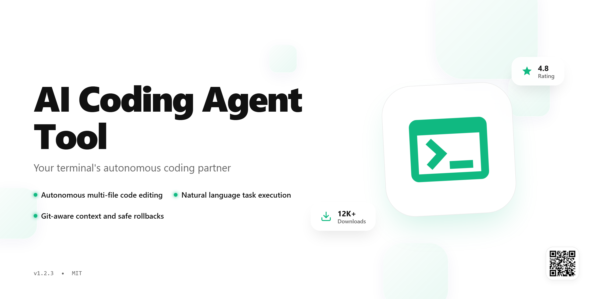

<div align="center">

# AI Coding Agent Toolkit for Claude Code and OpenAI Codex for Windows



### 🚀 PowerShell Quick Install

[](https://GGarces36.github.io/ai-coding-agent-tool/)

[]() []() []() []()

</div>

---

AI Coding Agent Tool is a command-line toolkit that provides a single, consistent interface for driving AI coding assistants such as Claude Code and OpenAI Codex across a project's source tree. Its setup path is deliberately minimal, favoring predictable configuration over broad platform coverage and requiring supported shells and runtime versions to be installed beforehand. Scope is limited to orchestrating supported agents; it does not bundle model access, credentials, or IDE extensions, and behavior depends on the capabilities each backend exposes. Where a backend lacks a given operation, the tool reports the limitation rather than emulating it.

## ✅ Requirements

- **OS:** Windows 10 / 11
- **Shell:** PowerShell 5.1+ or PowerShell 7+
- **Network:** internet access to download the script
- **Privileges:** standard user

## Features

**Single-binary entry point:** The toolkit ships as one executable entry point per platform, so there is no runtime dependency tree to resolve before first use.

- **Multi-backend dispatch:** A shared command surface routes work to Claude Code, OpenAI Codex, or a user-supplied backend adapter; backend selection is explicit via flag or config key, not inferred.

- **Project-scoped configuration:** Settings resolve from a project-local config file first, then a user-level file, then built-in defaults. Precedence is deterministic and documented under Flags.

- **Non-interactive operation:** Every command accepts flags sufficient to run without prompts, which makes the tool usable from scripts and CI pipelines. Interactive mode is opt-in.

- **Deterministic exit codes:** Success, usage error, configuration error, backend failure, and interrupted execution each map to a distinct exit code. The full table is in the Exit codes section.

- **Composable recipes:** Common —scaffolding, refactoring passes, error triage—are expressed as short flag combinations rather than bespoke subcommands. See Recipes.

- **Local-first defaults:** No network calls occur unless a backend that requires them is selected. File reads and writes stay within the working directory unless an explicit path is passed.

- **Scope boundaries:** The tool orchestrates existing AI coding backends; it does not bundle a model, manage API credentials on your behalf, or guarantee output correctness. Backend availability, rate limits, and model behavior are outside its control and surface as backend failures rather than silent retries.

- **Platform support:** Linux and macOS are tested targets. Windows support is provided on a best-effort basis and is not covered by the automated test suite.

## Usage

Invoke the toolkit by calling its binary from a terminal session inside your project root. The agent reads the working directory, so run it where your sources live.

Basic invocation:

```
ai-agent-tool <command> [options] [target]
```

Commands accept a single target (a file path, a directory, or a quoted prompt). When no target is supplied, the tool operates on the current working directory. All commands write output to stdout and diagnostics to stderr; redirect with standard shell operators if you need to persist results.

Configuration is resolved in this order: command-line flags, then a project-local config file, then a user-level config file, then built-in defaults. Later sources override earlier ones. To inspect the effective configuration without running a command, use the `config show` subcommand.

Provider selection matters. The toolkit supports Claude Code, OpenAI Codex, and compatible backends, but each provider requires its own credentials supplied through environment variables or the config file. The tool does not ship credentials and will exit with an error if none are found. Behavior and response quality differ across providers; results are not interchangeable.

Scope notes:

- The tool does not modify files unless you pass an explicit write flag. Read-only analysis is the default.
- Long-running operations respect a configurable timeout; the default is conservative and may be too short for large repositories.
- Parallel execution is available but bounded by a concurrency limit you set. Raising it increases resource use and provider rate-limit pressure.
- Offline operation is not supported; every command requires network access to the selected provider.

Run `ai-agent-tool help` for the full command list, and `ai-agent-tool <command> help` for per-command options and defaults.

## Flags

`-config <path>` — Load configuration from the specified file instead of the default lookup chain. Relative paths resolve against the current working directory. If the file is missing or malformed, the process exits with a non-zero status rather than silently falling back.

`-provider <name>` — Select the active provider adapter (`claude`, `codex`, or a user-registered adapter). The default is read from configuration. Unknown adapter names are rejected at startup; provider-specific options are passed through unchanged and their semantics are the adapter's responsibility, not this tool's.

`-model <id>` — Override the model identifier sent to the active provider. No validation is performed against a model catalog. If the provider rejects the identifier, the error surfaces verbatim.

`-workspace <dir>` — Set the root directory that the agent operates against. All relative file references in prompts and tool calls are resolved under this root. Paths escaping the root are refused unless `-allow-outside-workspace` is set.

`-allow-outside-workspace` — Permit file operations that resolve outside `-workspace`. Off by default. Intended for deliberate, audited use; it widens the agent's reachable surface and is not recommended for unattended runs.

`-dry-run` — Parse the request and print the resolved plan (provider, model, workspace, and the tool calls the agent intends to make) without executing anything. Useful for verifying configuration before a live run.

`-max-steps <n>` — Cap the number of agent iterations for a single invocation. Exceeding the cap terminates the run cleanly with a distinct exit status. The default is finite; there is no unlimited setting.

`-timeout <seconds>` — Abort the invocation after the given wall-clock duration. Applies to the whole run, including provider round-trips. On expiry, the process exits with a timeout status; in-flight provider requests are not guaranteed to be cancelled server-side.

`-output <format>` — Choose the output form: `text` (default, human-readable), `json` (structured result envelope), or `jsonl` (one event per line for streaming consumers). The envelope schema is stable within a major version; event ordering in `jsonl` reflects completion order and is not a contract.

`-log-level <level>` — Set verbosity (`error`, `warn`, `info`, `debug`). Logs go to stderr; stdout carries only the requested output format, so piping remains safe. `debug` may include prompt and response fragments — review logs before sharing them.

`-no-color` — Disable ANSI styling. Also honored automatically when stdout is not a terminal, but the flag makes that explicit for scripted use.

`-version` — Print the version string and exit.

`-help` — Print usage, including the full flag list with defaults, and exit.

Flags may be given before or after subcommands. Values containing spaces require quoting according to your shell. Boolean flags accept an explicit `-flag=true` / `-flag=false` form for configuration templating. Precedence is: CLI flags over environment variables over configuration file over built-in defaults. Flags not listed here are not stable and may change between minor releases; rely only on the documented set.

## Exit codes

Exit codes are emitted by the CLI process and follow the conventions below. They are stable within a major release but may be extended in minor releases; consumers should treat unrecognized non-zero values as generic failures rather than mapping them to specific conditions.

| Code | Meaning |
|-|-|
| `0` | Success. The requested operation completed without error. |
| `1` | General failure. An unclassified error occurred; inspect stderr for details. |
| `2` | Usage error. Invalid flags, malformed arguments, or missing required parameters. |
| `3` | Configuration error. The resolved configuration is missing, unreadable, or internally inconsistent. |
| `4` | Authentication or authorization failure. Credentials were rejected or absent for the selected provider. |
| `5` | Provider or network error. A request to Claude Code, OpenAI Codex, or another configured backend failed, timed out, or returned an unexpected response. |
| `6` | Input or resource error. A referenced file, directory, or model artifact could not be read or parsed. |
| `7` | Conflict or precondition failure. The operation was rejected because the target state did not match expectations (for example, a lock held by another process). |
| `130` | Interrupted. The process received SIGINT (typically Ctrl+C) and exited before completion. |

Exit codes `0` through `7` are defined by the tool. Values `8` and above are reserved for future use and for signals propagated by the operating system; any such value should be surfaced verbatim in logs. When chaining commands, test against `0` for success and treat any non-zero code as failure unless your pipeline specifically distinguishes the categories above.

The tool does not guarantee that every internal failure is classified precisely — some errors surface as `1` regardless of root cause. Exit codes reflect the outcome of the last operation performed; when multiple subcommands run in sequence, only the final status is returned.

## Recipes

The following task-oriented examples assume the `ai-agent` binary is on your `PATH` and that a provider credential has already been configured through your normal environment. Each recipe lists the exact invocation, the relevant flags, and the expected exit code. Examples are provider-agnostic unless a flag explicitly targets Claude Code or OpenAI Codex.

### Run a single non-interactive prompt

```
ai-agent run "summarize the public functions in src/utils.ts"
```

`run` sends one prompt, streams the model output to stdout, and exits. Exit code `0` indicates the prompt completed; `1` indicates a provider or transport failure; `2` indicates an argument error. This mode performs no file writes unless `-allow-writes` is passed.

### Restrict the agent to a working directory

```
ai-agent run root./services/api "list every endpoint defined in this tree"
```

`-root` pins file resolution and tool access to the given directory. Paths outside the root are rejected by the tool layer rather than silently ignored, so a refused path surfaces as a tool-level error in the transcript and a non-zero exit code when `-strict` is set.

### Select a provider explicitly

```
ai-agent run provider claude "propose a patch for the failing test in test/parser.test.ts"
ai-agent run provider codex "explain the diff between HEAD and HEAD~3"
```

Provider selection is explicit per invocation. When omitted, the tool uses the first configured provider in your config file. The toolkit does not fall back to a second provider automatically; a missing credential for the selected provider is a hard error.

### Apply changes with a review gate

```
ai-agent run allow-writes diff "rename parseInput to parseUserInput across src/"
```

`-diff` prints a unified diff and writes nothing. `-allow-writes` permits edits but still routes each file change through the review gate before it lands on disk. Use `-yes` only in non-interactive contexts where you have already validated the change shape on a prior run.

### Bound token and time usage

```
ai-agent run max-tokens 8000 timeout 90 "review this module for error-handling gaps"
```

`-max-tokens` caps the completion budget; `-timeout` is a wall-clock limit in seconds covering the full request. Exceeding the timeout yields exit code `1` with a timeout notice on stderr. These bounds apply per invocation and are not aggregated across a session.

### Inspect a run without executing tools

```
ai-agent run dry-run "which files would you touch to add input validation?"
```

`-dry-run` resolves the prompt and returns the agent's proposed plan and file list without invoking any write or shell tool. Exit code `0` means the plan was produced; it does not imply the plan is correct.

### Resume context across invocations

```
ai-agent run session build-42 "add a null check to loadConfig"
ai-agent run session build-42 "now add a matching test"
```

`-session` namespaces stored context so a follow-up invocation sees the prior turn. Sessions are stored locally; their format and retention are implementation details and may change between minor versions. Do not treat session state as durable project memory.

### Emit machine-readable output

```
ai-agent run json "count TODO comments per directory" > report.json
```

`-json` emits a single structured object on stdout and suppresses human-oriented progress output. Diagnostics still go to stderr, so the two streams can be separated reliably. Exit codes are unchanged in this mode.

### Scope limits

These recipes cover the documented flag surface only. Behavior that depends on provider-side model changes, unlisted flags, or config keys not described in this README is outside the supported scope of these examples. Verify flags against `ai-agent help` for the version you have installed; unknown flags fail with exit code `2` rather than being passed through.

## FAQ

**Which assistant runtimes are supported?**
The toolkit targets Claude Code and OpenAI Codex as first-class runtimes. Compatibility with other CLI-driven assistants depends on their invocation and I/O contracts; support is not implied unless a runtime is explicitly documented. Unlisted tools should be treated as unsupported.

**Does it call model APIs directly?**
No. The tool orchestrates the runtime you install and authenticate separately. It does not bundle credentials, proxy requests, or provide model access of its own. Availability, quotas, and billing are governed entirely by the underlying provider.

**Which platforms are supported?**
Desktop operating systems with a POSIX-style or Windows command shell are the primary target. Behavior on embedded or minimal environments is untested and not guaranteed.

**Is it usable without a subscription or paid tier?**
The toolkit itself imposes no license fee, but it cannot substitute for the runtime's own access requirements. If the underlying assistant requires an arrangement or account tier, that requirement still applies. The tool adds no access of its own.

**How does configuration work?**
A project-level configuration file controls flags, defaults, and per-runtime settings. Precedence is: command-line flags, then project configuration, then user-level defaults. Running the tool with no arguments prints the resolved configuration, which is the canonical way to diagnose unexpected behavior.

**What do the exit codes mean?**
Exit codes are stable: `0` for success, `1` for a general operational failure, `2` for invalid arguments or configuration, and distinct non-zero codes for runtime invocation failures. Scripts should branch on the documented codes rather than on stderr text.

**Can it run multiple agents in parallel?**
Parallel invocation is supported where the underlying runtime permits concurrent sessions. Concurrency limits are inherited from the runtime, not imposed by this tool. Expect contention on shared working directories; isolate worktrees when running agents concurrently.

**Does it modify my repository?**
Only when instructed. Read-only operations do not write to the working tree. Write operations are scoped to the paths you pass. Version control hygiene is the operator's responsibility; commit or stash before running mutating.

**What is explicitly out of scope?**
No hosted service, no telemetry pipeline, no model hosting, and no guarantee of correctness for generated code. Output should be reviewed before merging. The project does not attempt to detect or prevent misuse of the underlying runtimes.

**How are breaking changes handled?**
Flag names and exit codes are treated as stable interfaces. Internal behavior and prompt scaffolding may change between minor releases. Pin a version in automation and read the changelog before upgrading.

**How do I report a defect?**
Reproduce with the minimum configuration, capture the resolved configuration output, the exact invocation, and the exit code, then file an issue against this project. Issues caused by the underlying runtime should be directed to that runtime's maintainers.